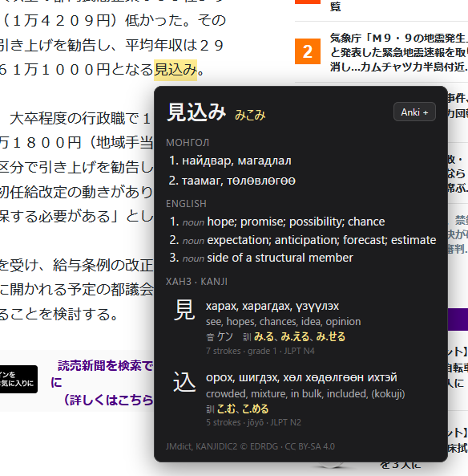

# Uudam Hover – Japanese Lookup (browser extension)



**Install for Firefox:** https://addons.mozilla.org/firefox/addon/uudam-hover-japanese-lookup/

Hold **Shift** and point at Japanese text on any page: the word under the mouse gets a yellow highlight and a
popup shows its reading, the Mongolian meaning when our dictionary has it, then the English meaning (JMdict).
Verb forms are shown as the dictionary word (読んでいました → 読む). Let go of Shift and move away, press
Escape, click, or scroll to close it.

Below the meanings, one row per kanji in the word: our Mongolian meaning, the English one (KANJIDIC2), on and
kun readings with the one used in this word in yellow, strokes, school grade and JLPT level. Click a row to
open the Mongolian note on how the kanji is built (`origin_mn`, for the 2,136 jōyō kanji).

**Anki**: the popup's **Anki +** button saves the word as a note through the AnkiConnect add-on (Anki must be
open). The first press opens the options page: **Connect to Anki**, then pick the deck, the note type and what
goes in each field (word, reading, furigana in Anki's `漢字[かんじ]` format, Mongolian, English, the sentence with
the word in bold, kanji, page address). A word already in the deck shows **In Anki ✓**.

A separate add-on from uudam (which only runs on Netflix), sharing its parts: kuromoji and `src/lookup.js`
for splitting text into words, and the JMdict data from `build-fallback.js`. Firefox first (Manifest V3,
Firefox 142+); `test/chromium-test.js` shows it also runs in Chromium with a service worker.

## Build and load in Firefox

1. Build uudam first (see `../README.md`): `node build.js` in the uudam folder, with JMdict in
   `../mongol-dict/ja-mn/sources/`.
2. Here: `node build.js` — copies `vendor/` (kuromoji, lookup.js), `data/` (dict.json, fallback-full/) and
   `icons/` from uudam, and writes `data/kanji.json` from `../mongol-dict/ja-mn/sources/kanjidic2.xml` (English
   meanings, readings, strokes, grade, JLPT; jōyō readings from uudam's `data/kanji.json`). Generated, not committed.
3. Firefox → `about:debugging#/runtime/this-firefox` → **Load Temporary Add-on…** → pick `hover/manifest.json`.
4. Open any page with Japanese, hold Shift and point at a word. The first lookup takes a few seconds while
   the dictionaries load.

## How it works

| File | Role |
|------|------|
| `src/content.js` | Runs in every page. Finds the character under the mouse, sends up to 40 characters around it (same paragraph, same sentence) to the background, highlights the word it gets back (CSS Custom Highlight API, so the page is not changed) and draws the popup in a shadow root |
| `src/background.js` | Loads kuromoji, our Mongolian words, all of JMdict and `data/kanji.json` once; splits the text with uudam's `segment()` and answers with the word at the mouse and its kanji; saves notes to Anki |
| `src/anki.js` | Talks to AnkiConnect (127.0.0.1:8765) and turns a word into a note from the stored settings. Used by the background and the options page |
| `options/` | Options page: connect to Anki, deck, note type, fields, tags (stored in `storage.local`); «Толь бичиг» box for dictionary updates |
| `vendor/dict-update.js`, `vendor/dict-panel.js` | Copies of uudam's dictionary updater (see `../README.md`): with the daily check on (or the button pressed) a newer mongol-dict release is downloaded from GitHub and used instead of `data/dict.json`. GitHub access is an optional permission asked for then; data only, nothing about the user is sent |

## Tests

- `npm install` in uudam once, then `node test/chromium-test.js` — loads the extension into headless Chromium
  and points at words on `test/page.html` with Shift held, then saves a word to a fake AnkiConnect on port 8765
  (skipped when Anki is open). Screenshots in `test/out/`. On Windows set `CHROMIUM` to a Chromium (not Chrome) exe.
- `npx web-ext lint --source-dir . --ignore-files test docs build.js README.md` — Mozilla's checks (0 warnings).

## License

Code: MIT (`../LICENSE`). Bundled data: as in uudam (JMdict © EDRDG, CC BY-SA 4.0; mongol-dict, CC BY-SA 4.0;
kuromoji.js and its dictionary, Apache 2.0), plus KANJIDIC2 © EDRDG (CC BY-SA 4.0) and Kanjium's jōyō readings
(CC BY-SA 4.0) in `data/kanji.json`.

## Building the addons.mozilla.org package

Build uudam's package first (see "Building the addons.mozilla.org package" in `../README.md`, up to and
including `node build.js`), then:

```sh
cd hover && node build.js
npx web-ext build --source-dir . --ignore-files test docs build.js README.md
```

The zip lands in `hover/web-ext-artifacts/`. It holds `src/` (our code, not minified), `vendor/kuromoji.js` and
`vendor/dict/` (kuromoji with the two changes `../build.js` makes, described in `../README.md`),
`vendor/lookup.js` (a plain copy of `../src/lookup.js`), and `data/` (JSON only: our Mongolian dictionary, JMdict and the kanji list).
